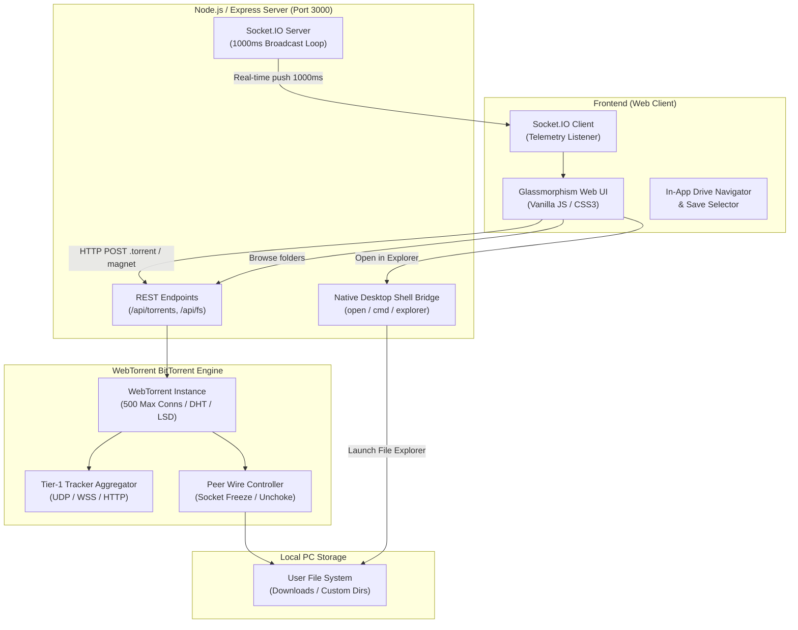

# 🌊 TorrentFlow

<p align="center">
  <strong>High-Speed BitTorrent Web Client & Engine with Real-Time Telemetry & Native Desktop Integration</strong>
</p>

<p align="center">
  
  
  
  
  
  
  
</p>

---

## 📖 Overview

**TorrentFlow** is a modern, high-performance web-based BitTorrent client designed for maximum download throughput, real-time download telemetry, and seamless desktop OS integration. Built on **Node.js**, **Express**, **WebTorrent**, and **Socket.IO**, TorrentFlow combines peer-to-peer concurrency with a sleek glassmorphic UI.

---

## ✨ Key Features

- **🚀 Hyper-Speed Peer Concurrency**:
  - Global pool of 500+ concurrent peer connections.
  - Full support for **DHT** (Distributed Hash Table), **uTP** (Micro Transport Protocol), **LSD** (Local Service Discovery), and **PEX** (Peer Exchange).
  - Multi-tier tracker aggregation across 20+ top global public trackers for fast peer discovery.

- **⚡ Live Bidirectional Telemetry (Socket.IO)**:
  - Real-time download/upload rates, progress percentage, ETA, peer count, and swarm stats pushed every second without polling.

---

## 🏗️ Architecture & System Design

TorrentFlow decouples client presentation from the background torrent engine using WebSocket events and REST endpoints.



---

## 🛠️ Technology Stack

| Domain | Technologies | Purpose |
| :--- | :--- | :--- |
| **Backend Runtime** | [Node.js](https://nodejs.org/) (ES Modules) | Asynchronous I/O runtime |
| **HTTP Framework** | [Express 4](https://expressjs.com/) | REST API routing and static asset delivery |
| **Torrent Engine** | [WebTorrent 2.x](https://webtorrent.io/) | Full BitTorrent protocol implementation (DHT, uTP, PEX, LSD) |
| **Real-Time Data** | [Socket.IO 4.x](https://socket.io/) | Full-duplex WebSocket telemetry pipeline |
| **File Uploads** | [Multer](https://github.com/expressjs/multer) | `.torrent` file parsing and multipart streaming |
| **OS Integration** | `open`, Windows Shell API | Direct execution for opening directories in native File Explorer |
| **Frontend UI** | HTML5, Vanilla JavaScript, CSS3 | Zero-dependency, performant glassmorphic client |

---

## 📁 Project Structure

```
TorrentFlow/
├── downloads/               # Default downloaded files location
├── temp/                    # Uploaded .torrent files processing area
├── public/                  # Frontend static assets
│   ├── css/
│   │   └── style.css        # Responsive glassmorphism styling & animations
│   ├── js/
│   │   └── app.js           # Client controller, Socket.IO, & DOM rendering
│   └── index.html           # Main single-page interface
├── server.js                # Core Express backend, WebTorrent manager & API
├── package.json             # NPM dependencies & scripts
└── README.md                # Project documentation
```

---

## 🚀 Getting Started

### Prerequisites
- **Node.js** (v18.x or higher recommended)
- **npm** (v9.x or higher)

### Installation

1. **Clone the repository**:
   ```bash
   git clone https://github.com/your-username/torrentflow.git
   cd torrentflow
   ```

2. **Install dependencies**:
   ```bash
   npm install
   ```

3. **Start the application**:
   ```bash
   npm start
   ```

4. **Open in browser**:
   Navigate to [http://localhost:3000](http://localhost:3000)

---

## 📡 API Reference

### Torrent Management
| Method | Endpoint | Description | Payload / Query |
| :--- | :--- | :--- | :--- |
| `GET` | `/api/torrents` | Retrieve all active downloads | *None* |
| `POST` | `/api/torrents/inspect-magnet` | Resolve metadata before starting download | `{ magnetURI }` |
| `POST` | `/api/torrents/inspect-torrent` | Parse uploaded `.torrent` metadata | `multipart/form-data` |
| `POST` | `/api/torrents/add-magnet` | Initiate magnet download with custom path | `{ magnetURI, savePath }` |
| `POST` | `/api/torrents/upload-torrent` | Initiate torrent file download | `multipart/form-data` |
| `POST` | `/api/torrents/:infoHash/pause` | Pause wire data transfer | *None* |
| `POST` | `/api/torrents/:infoHash/resume` | Resume wire data transfer | *None* |
| `DELETE` | `/api/torrents/:infoHash` | Delete torrent (and optionally physical files) | `?deleteFiles=true\|false` |

### File System & Shell
| Method | Endpoint | Description | Payload |
| :--- | :--- | :--- | :--- |
| `GET` | `/api/fs/places` | List Windows drives (`C:\`, `D:\`) & shortcuts | *None* |
| `POST` | `/api/fs/list` | List directories within a target path | `{ targetPath }` |
| `POST` | `/api/fs/create-folder` | Create new directory on local disk | `{ parentPath, folderName }` |
| `POST` | `/api/open-folder` | Open target directory in Windows File Explorer | `{ folderPath, torrentName, infoHash }` |

---

## ⚡ Performance Optimizations

1. **Wire-Level Socket Throttling**: Rather than letting the BitTorrent engine buffer unrequested data when paused, TorrentFlow explicitly invokes `.uninterested()` on all peer wires, cancels in-flight piece requests, and calls `._socket.pause()` on underlying TCP streams.
2. **Aggressive Tracker Seeding**: Every magnet link and `.torrent` file is dynamically injected with Tier-1 high-availability public trackers (UDP & WebSockets), maximizing swarms even for low-seed torrents.
3. **Hardware Acceleration**: CSS backdrop filters, transforms, and canvas particle animations run on dedicated GPU composite layers without impacting I/O throughput.

---

## 📄 License

This project is licensed under the [MIT License](LICENSE).
